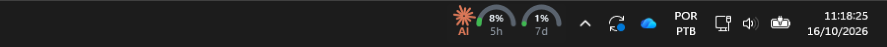
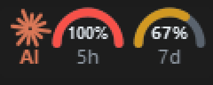
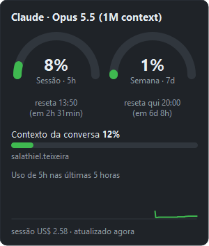
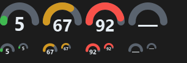

# Claude Usage Widget

Widget para Windows 11 que mostra o uso do Claude Code na barra de tarefas:
limite da sessão (janela de 5h), limite semanal (janela de 7d), uso do contexto e custo da sessão.

> Projeto **não oficial**, sem afiliação com a Anthropic. O logo é um asterisco genérico
> desenhado no código.



## O que mostra

- **Mini-cartão na barra de tarefas**, à esquerda da bandeja: logo e dois semicírculos (5h e 7d).
- **Dois ícones na bandeja**: 5h e 7d, com o número dentro.
- **Tooltip** (no cartão e nos ícones): 5h, 7d, contexto, horários de reset e idade do dado.
- **Painel** (clique esquerdo): semicírculos grandes, contagem regressiva, barra de contexto,
  custo da sessão e gráfico do 5h nas últimas 5 horas.
- **Menu** (clique direito): Mostrar painel · Mostrar na barra de tarefas · Iniciar com o Windows · Sair.

| Cartão | Painel | Ícones |
|---|---|---|
|  |  |  |

## Como funciona

```
Claude Code ──stdin JSON──> statusline.ps1 ──> run-python.cmd python statusline.py
                                                   ├─ imprime a linha do rodapé
                                                   ├─ grava usage.json (escrita atômica)
                                                   ├─ grava last_input.json (JSON cru, debug)
                                                   └─ acrescenta history.jsonl (1 amostra/min)
widget.pyw (PyQt5) ──lê a cada 5 s──> usage.json + history.jsonl
```

Os dados só mudam enquanto o Claude Code está em uso, porque a statusline roda a cada resposta.
Campos ausentes no JSON aparecem como "—". Depois do `resets_at`, o widget mostra 0%.

> **Os limites 5h e 7d só aparecem para assinantes Pro/Max.** Segundo a
> [documentação da statusline](https://code.claude.com/docs/en/statusline), o campo
> `rate_limits` só é enviado para assinantes claude.ai Pro e Max (ou atrás de um gateway com
> limite de gasto) e só depois da primeira resposta da sessão. Quem usa chave de API vê "—" no
> 5h e no 7d; o contexto e o custo continuam funcionando.

## Arquivos

| Arquivo | Papel |
|---|---|
| `statusline.ps1` | ponte chamada pelo Claude Code; força UTF-8 e repassa o stdin |
| `statusline.py` | só biblioteca padrão; grava os JSON e imprime o rodapé |
| `run-python.cmd` | acha um Python 3 instalado (ver abaixo) e roda o script com ele |
| `widget.pyw` | o widget (PyQt5 + ctypes/winreg) |
| `iniciar-widget.vbs` | abre o widget sem janela de console |

## Requisitos

- Windows 11 (no Windows 10 deve funcionar, mas não foi testado).
- **Qualquer Python 3.8 ou mais novo**, com o **PyQt5** instalado para o widget.
  - A statusline (`statusline.py`) só usa a biblioteca padrão, então roda com qualquer Python 3.8+.
  - O widget (`widget.pyw`) precisa do PyQt5 5.15.
  - Quem tem **QGIS** instalado não precisa de mais nada: o Python do QGIS já vem com o PyQt5
    e é usado automaticamente quando nenhum outro Python com PyQt5 é encontrado.

### Qual Python é usado

O `run-python.cmd` procura, nesta ordem, e usa o primeiro que funcionar:

1. a variável de ambiente `CLAUDE_WIDGET_PYTHON` (caminho completo de um `python.exe`);
2. o launcher `py -3` (instalado junto com o Python do python.org);
3. o `python` no PATH;
4. o Python do QGIS mais recente em `C:\Program Files\QGIS *`.

Para abrir o widget, ele só aceita um Python que consiga importar o PyQt5. Por isso, a statusline
e o widget podem acabar usando Pythons diferentes, e tudo bem. O atalho falso `python.exe` da
Microsoft Store (o que só abre a loja) é ignorado. Para forçar um Python, defina
`CLAUDE_WIDGET_PYTHON`.

## Instalação

1. Sem QGIS: instale o Python 3.8+ pelo [python.org](https://www.python.org/downloads/) e rode
   `py -m pip install -r requirements.txt`. Com QGIS, pule este passo.
2. Copie a pasta para `C:\Users\<usuario>\.claude\usage-widget`.
3. Em `~/.claude/settings.json`, adicione (troque `<usuario>`, e use **barras normais**):

   ```json
   "statusLine": {
     "type": "command",
     "command": "powershell -NoProfile -File C:/Users/<usuario>/.claude/usage-widget/statusline.ps1"
   }
   ```

4. Dê dois cliques em `iniciar-widget.vbs`. Para abrir com o Windows, use a opção do menu
   (clique direito no cartão ou nos ícones).

## Solução de problemas

- No Windows, o Claude Code roda a statusline pelo **Git Bash, se estiver instalado; senão, pelo PowerShell**.
- No PowerShell, um comando que começa com um caminho entre aspas (`"C:\...\x.cmd" args`) é
  tratado como string e **falha sem erro visível**. No Git Bash, as barras invertidas são comidas.
  O formato `powershell -NoProfile -File` com caminho de barras normais funciona nos dois.
- Testar com `powershell -Command $cmd` engana, porque o PS 5.1 descarta as aspas internas.
  Para simular o stdin, use `System.Diagnostics.Process`.
- A statusline também pode ficar em branco por estes motivos: pasta sem confiança aceita
  (workspace trust), `disableAllHooks: true`, ou script que sai com código ≠ 0 ou sem stdout.
  Para diagnosticar, use `claude --debug`.
- O widget não abre: rode `run-python.cmd pythonw widget.pyw` num `cmd` para ver a mensagem.
  Se aparecer "Nenhum Python com PyQt5", rode `py -m pip install PyQt5`.

## Limitações conhecidas

- O Windows 11 não tem API para widgets na barra de tarefas. O cartão é uma janela "owned" pela
  `Shell_TrayWnd`, reposicionada a cada 1 s. Ele some com app em tela cheia, com a barra
  oculta (autohide) ou com a barra vertical, e pode cobrir os ícones dos apps se a barra estiver cheia.
- Só testado em 1920×1080 com escala de 100%. Ainda não foi testado com vários monitores, no
  Windows 10 ou depois de reiniciar o Explorer.
- Depois de reiniciar o widget, o Windows pode esconder os 2 ícones dentro do "^".
- O Windows limita o tooltip da bandeja a 127 caracteres.

## Licença

[MIT](LICENSE).
